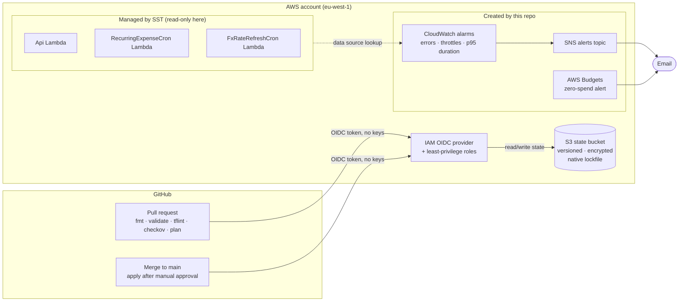

# BudgetTracker Infrastructure (Terraform)

Terraform that adds **monitoring, cost controls and CI/CD guardrails** around a live serverless app, without touching the app itself.

BudgetTracker is a personal finance app running on AWS Lambda, deployed with [SST](https://sst.dev). SST owns the application. This repo sits around it: it reads the SST-managed functions through read-only data sources and creates only new resources for alerting and governance.

## Status

| Component | Status |
|---|---|
| Remote state bootstrap (S3, versioned, encrypted, native locking) | ✅ Applied |
| Lambda monitoring module (errors, throttles, p95 duration → SNS email) | ✅ Built and validated (deploys with `dev`) |
| AWS Budgets module (zero-spend alert) | ✅ Built and validated (deploys with `dev`) |
| `dev` environment wiring the modules | 🚧 In progress |
| GitHub Actions CI/CD with OIDC (no stored AWS keys) | 🚧 In progress |

## Architecture



## Terraform skills shown

| Skill | Where |
|---|---|
| Bootstrapping remote state (the chicken-and-egg problem) | [`bootstrap/`](bootstrap/) |
| S3 native state locking (`use_lockfile`), replacing DynamoDB locking (deprecated in Terraform 1.11) | [`bootstrap/versions.tf`](bootstrap/versions.tf) |
| Hardened S3: versioning, SSE, public access block, ACLs disabled, TLS-only bucket policy, lifecycle expiry | [`bootstrap/main.tf`](bootstrap/main.tf) |
| `prevent_destroy` on critical resources | [`bootstrap/main.tf`](bootstrap/main.tf) |
| Reusable modules with typed, validated inputs and `sensitive` variables | [`modules/lambda-monitoring/variables.tf`](modules/lambda-monitoring/variables.tf) |
| `for_each` over a map with stable keys, so renaming an upstream resource updates in place and nothing is recreated | [`modules/lambda-monitoring/alarms.tf`](modules/lambda-monitoring/alarms.tf) |
| Data sources to reference resources owned by another tool, without importing them | [`modules/lambda-monitoring/main.tf`](modules/lambda-monitoring/main.tf) |
| Derived values (alarm threshold computed from each function's own timeout) | [`modules/lambda-monitoring/alarms.tf`](modules/lambda-monitoring/alarms.tf) |
| Least-privilege resource policies with confused-deputy protection (`aws:SourceAccount`) | [`modules/lambda-monitoring/main.tf`](modules/lambda-monitoring/main.tf) |
| Policy-as-code scanning with documented, justified `checkov` skips | inline `#checkov:skip` comments |
| Version pinning: exact range in roots, minimum only in modules, committed `.terraform.lock.hcl` | `versions.tf` files |

## Key decisions and trade-offs

| Decision | Why | Trade-off accepted |
|---|---|---|
| **Terraform wraps SST, never manages it** | One owner per resource. Two IaC tools managing the same resource fight each other and cause drift. | Terraform can't fix app config; it can only observe it. |
| **S3 native locking over DynamoDB** | GA since Terraform 1.11, no extra table or IAM, $0. DynamoDB locking is deprecated. | Requires Terraform ≥ 1.11. |
| **Bootstrap keeps local state** | The bucket can't hold its own state before it exists. | Losing the laptop file means re-adopting the bucket with `terraform import`. The bucket and all app state stay safe. |
| **SSE-S3 instead of a customer-managed KMS key** | Saves $1/month per key on a free-tier project. | No key-level access control or CloudTrail key-usage audit. |
| **Error count ≥ 1 instead of error rate** | A rate alarm uses two metrics, which pushes the alarm count past the 10 in the free tier. At personal-app traffic every error matters. | Would be too noisy at high traffic, where a rate is the right signal. |
| **p95 duration at 80% of timeout** | Warns before requests actually time out, and follows timeout changes automatically. | Measures tail latency only. |
| **1-of-1 evaluation, missing data = not breaching** | The cron functions run once a day, so multi-period rules would never fire. | A single slow period can alert. |
| **Unencrypted SNS topic** | CloudWatch can't publish to topics using the AWS-managed SNS key. A customer-managed key costs money. | Alert text (alarm names, states) is not sensitive. |

## Repository layout

```
bootstrap/                  One-off: creates the remote state bucket (local state)
modules/
  lambda-monitoring/        CloudWatch alarms + SNS email alerts for existing Lambdas
  budgets/                  AWS Budgets zero-spend cost alert
environments/
  dev/                      (in progress) Wires modules together, S3 backend
.github/workflows/          (in progress) PR checks and gated apply via OIDC
```

## How to run

Prerequisites: Terraform ≥ 1.11 and AWS credentials (this project uses an SSO profile).

```bash
# 1. One-off: create the state bucket
cd bootstrap
cp terraform.tfvars.example terraform.tfvars
terraform init
terraform plan -out=bootstrap.tfplan
terraform apply bootstrap.tfplan   # note the state_bucket_name output

# 2. Environment (available once environments/dev lands)
cd ../environments/dev
cp terraform.tfvars.example terraform.tfvars   # fill in function names and alert email
terraform init -backend-config="bucket=<state_bucket_name>"
terraform plan -out=dev.tfplan
terraform apply dev.tfplan
```

After the first apply, confirm the SNS subscription from the email AWS sends. Alerts are not delivered until you do.

## Cost

Designed to run at **≈ $0/month**:

| Item | Free-tier allowance | Used |
|---|---|---|
| CloudWatch standard alarms | 10 alarm metrics | 9 |
| SNS email notifications | 1,000 / month | A handful |
| AWS Budgets | Budgets without actions are free | 1 |
| S3 state storage | Kilobytes | < $0.01 |
| GitHub Actions | Free for public repos | — |

## What this project deliberately does not do

- **Manage the application.** No Lambda, API or IAM changes to SST resources, and no `terraform import` of them.
- **Dashboards, tracing or log analytics.** Alarms answer "is something wrong"; deeper observability is out of scope.
- **Multiple environments.** Only `dev` is wired up, because that's the stage the app actually uses. The module layout supports adding more.
- **Customer-managed KMS keys, cross-region replication or access logging.** Each one is a deliberate cost trade-off, documented next to the code.
- **Commit any account IDs, ARNs or emails.** Real values live in git-ignored `terraform.tfvars` and GitHub secrets.
